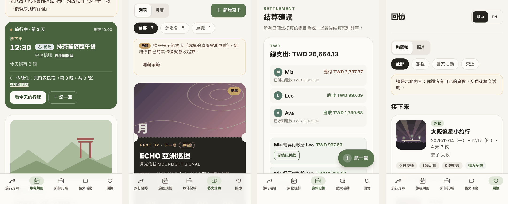
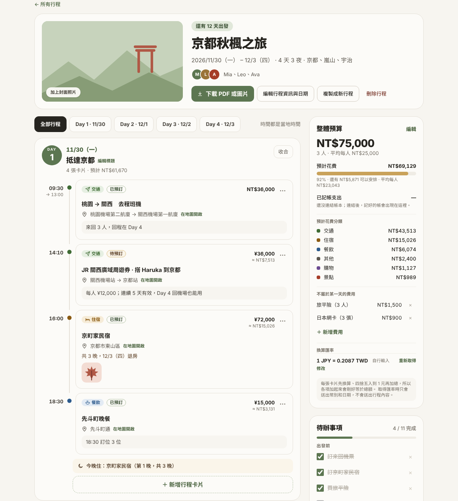
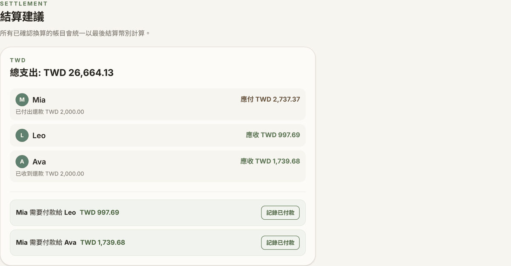
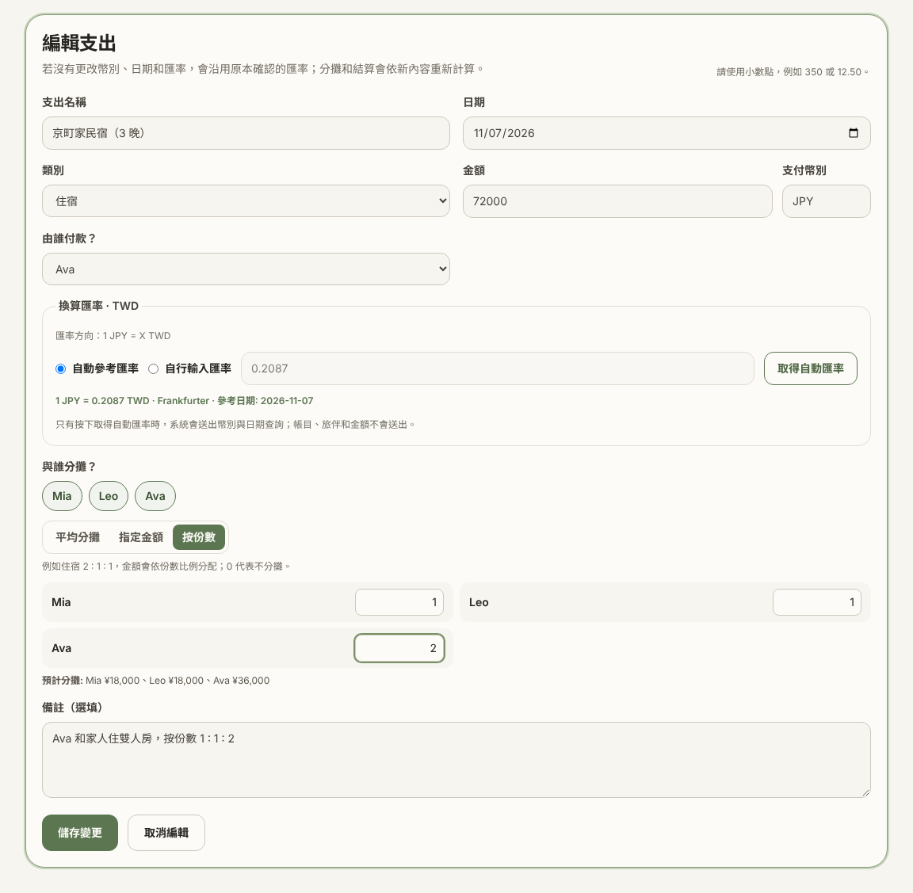
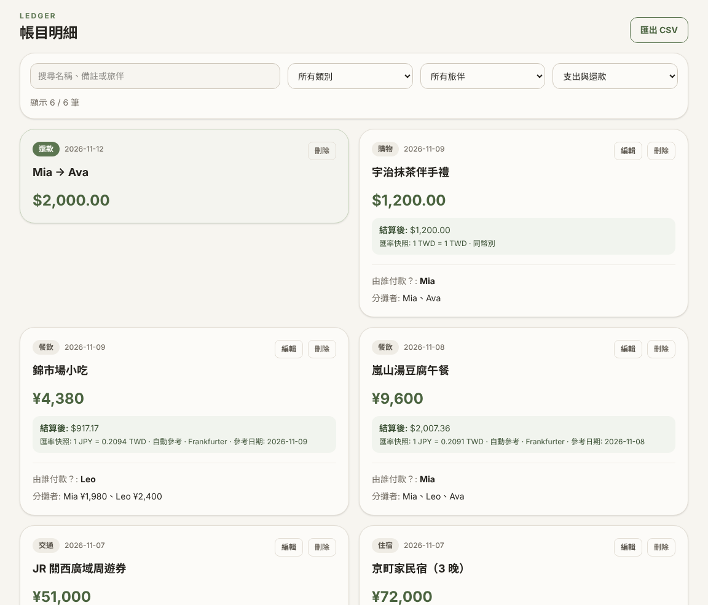
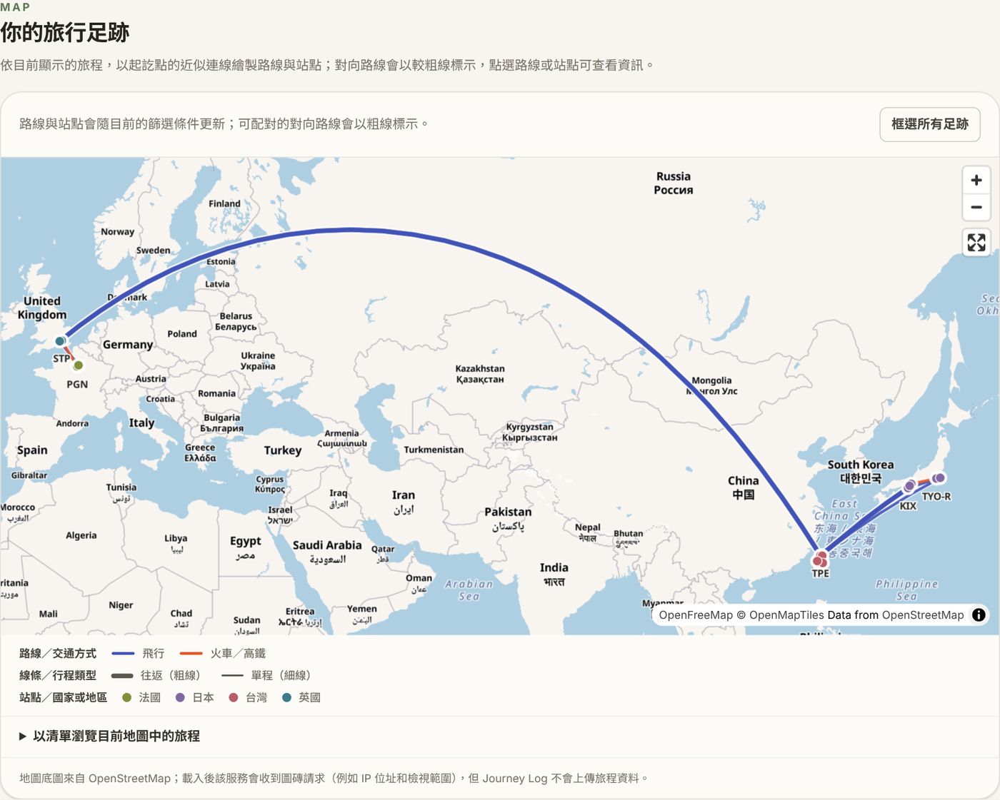
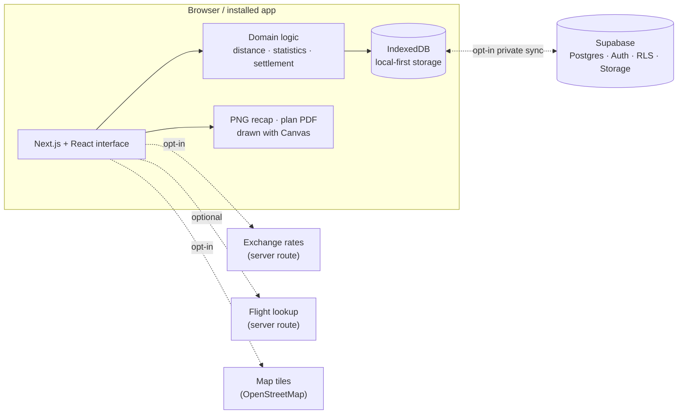

# Journey Log — travel tracker, trip planner & expense splitter

**Live app:** https://journey-log-beta.vercel.app

Journey Log is a local-first, installable web app (PWA) for recording flights,
rail / high-speed rail, cruises and other journeys. It turns them into
statistics, an interactive route map and a shareable PNG recap, includes a
day-by-day trip planner that exports to PDF or an image, and a multi-currency
ledger for splitting travel expenses with friends. Data stays on the device by
default, with optional private cloud sync.

This repository is the public overview of the project. The source code is kept
private; see [Source code](#source-code).

> 簡介：Journey Log 是一個「資料先存在自己裝置」的旅程紀錄 App，可記錄飛行、火車／高鐵與郵輪，自動產生統計、互動路線地圖與可分享的足跡報告圖片；出發前可以用「旅程規劃」一天天安排行程卡片（時間、地點、照片或插圖、預訂狀態）、待辦清單和預算，並下載成 PDF 或長圖；也內建多幣別的旅伴分帳功能（可平均、依金額或按份數分攤，記錄還款，每趟旅行各自一本帳，並能匯出 CSV）。也能用 CSV 一次匯入過去的航班紀錄，並以護照風格的國旗列顯示去過的國家／地區。可以安裝到手機主畫面，並能選擇以 Email 驗證碼登入，在自己的裝置間私有同步。介面支援繁體中文與英文。
>
> 為什麼做這個 App：我很喜歡旅行，以往都用 Flighty 記錄飛行足跡，但它只能記航班，在歐洲常搭的火車和高鐵都沒辦法記錄。和朋友出遊分帳時，用過的記帳 App 往往不直覺、不能自動換匯，或有很多廣告。所以我做了一個自己想用的工具：所有交通方式記在同一個地方、分帳清楚、沒有廣告，資料也留在自己手上。

## Screenshots

| Journeys & statistics | Phone (installable PWA) |
| --- | --- |
|  |  |

| Trip planner: days, cards, budget & to-dos | Plan exported as an A4 PDF |
| --- | --- |
|  |  |

| Shareable PNG recap | Ledgers, settlement & repayments |
| --- | --- |
|  |  |

| Uneven splits & editing | Expense history: search, filters, CSV |
| --- | --- |
|  |  |

*Screenshots use the app's fictional sample data. The live app has sample
journeys and a sample ledger you can try without signing in.*

## Features

- **Journey log** — flights, rail / high-speed rail, cruises and other trips,
  with autocomplete over ~9,800 airports and 76,000+ rail stations bundled
  with the app, operator recognition from flight / train numbers, and
  time-zone-aware durations. Journeys are grouped by year, and the cards are
  laid out for phones first.
- **Flight lookup** — pick a route and date to list that day's flights; choosing
  one fills in the number, airline, times and aircraft (optional, through a
  server-side route).
- **Bulk flight import** — paste or upload a CSV to add a whole flight history
  at once; duplicates are skipped, and missing times get labelled estimates.
- **Passport-style flags** and **statistics** — countries visited, distance,
  travel time (shown in days and years when long), "laps of the Earth", the
  longest and shortest journey per mode, and per-year summaries, with
  multi-select filters and search.
- **Maps** — an opt-in interactive map, and a PNG recap whose footprint map
  fits itself to where you have travelled and adds close-ups for dense regions,
  drawn entirely in the browser.
- **Trip planner** — plan each day with cards for transport, stays, sights,
  food and shopping: local times, places with a map link, booking status,
  notes, photos (resized, location data removed) or built-in illustrations,
  and expected costs in any currency. A to-do list with owners and due dates,
  an ideas list (cards from days removed by a date change land there instead
  of being deleted), key information, and a budget that compares planned costs
  with what the linked ledger has recorded. Download it as a paginated A4 PDF
  or a phone-width image, with costs, notes, photos and private details each
  optional.
- **Trip expense splitting** — expenses in about 150 currencies settle into one
  currency using a frozen per-expense exchange-rate snapshot. Split equally, by
  exact amounts or by shares, edit entries, record repayments, keep one ledger
  per trip, filter, and export to CSV. A sample ledger shows a finished trip.
- **Local-first & private** — works offline as an installable app; optional
  private cloud sync with row-level security and conflict-aware merging.
- **Bilingual** — every screen in Traditional Chinese and English.

## How it works

Nothing leaves the device unless the person opts in: cloud sync, map tiles and
exchange-rate lookups are each switched on deliberately, and the PNG recap and
plan PDF are generated in the browser.

## Tech stack

Next.js (App Router) · React · TypeScript (strict) · Tailwind CSS ·
Dexie / IndexedDB · Zod · MapLibre GL · Canvas 2D · Supabase (Postgres, Auth,
Row Level Security) · Vitest · Playwright · GitHub Actions · Vercel

## Engineering highlights

- **Money is never a float.** Amounts are stored in integer minor units;
  currency conversion uses exact decimal arithmetic, and largest-remainder
  allocation makes every split add up exactly to the total.
- **Frozen exchange rates.** Each expense keeps the rate confirmed when it was
  recorded, so later rate changes never rewrite a settlement.
- **Report map.** A fitted Web-Mercator projection chooses its central meridian
  from the largest empty longitude gap (so trans-Pacific routes are not split),
  clusters dense regions into numbered close-ups, and places labels to avoid
  collisions.
- **Sync safety.** Every cloud write is revision-checked in a Postgres
  function; concurrent edits are surfaced for the person to resolve instead of
  being silently overwritten.
- **One rate per currency.** A trip plan converts every card with a single rate
  per currency and rounds each card before adding up, so every day subtotal,
  category subtotal and the total agree exactly.
- **PDF without a font download.** Plan pages are drawn on a canvas, so Chinese
  text looks exactly as on screen, measured first so page breaks fall between
  days, and written into a small hand-built PDF.
- **Backward compatible.** Multiple ledgers and repayments needed no database
  migration; trip planning added its tables in an additive migration (tested
  on a local Postgres first), and devices keep plans queued until the cloud
  has been updated, while everything else keeps syncing.
- **Tested.** 200+ unit tests cover the business logic, and Playwright
  end-to-end tests run the main flows on desktop and mobile viewports against
  the production build. Lint, type-check, unit tests, the build and the
  end-to-end tests run automatically on every change.

## How this was built

This is a personal portfolio project developed with AI coding agents (OpenAI
Codex and Anthropic Claude). I defined the product and its requirements,
directed the design decisions, wrote the rules the agents follow, and reviewed
and tested the results.

Examples of decisions I made along the way:

- **Scope** — one log for flights, rail and cruises, plus an expense ledger,
  instead of separate apps.
- **Privacy** — data stays on the device by default; cloud sync is opt-in and
  private to each account.
- **iPhone Home Screen sign-in** — after finding that emailed sign-in links open
  in Safari rather than the installed app, switching to a one-time code and
  testing it on a real device.
- **Design** — a calm, low-saturation palette, and report maps that zoom to
  where I have actually travelled.
- **Data quality** — after spotting a journey saved with the arrival in the
  wrong year, adding a check that questions implausibly long journeys before
  saving them.
- **Trip planner** — reviewed the layout on a design canvas before any code was
  written: chose private sync from the start, rounded day cards with larger day
  and date labels for the PDF, a different colour for each category, and
  leaving booking codes out of exports by default.

## Source code

The source code is in a private repository, because I may develop Journey Log
further and release it. If you are reviewing my work for a role and would like
to see the code, please contact me through
[LinkedIn](https://www.linkedin.com/in/hsi-liang-claire/) and I will gladly
give you read access or walk you through it.

## License

© 2026 Claire Liang (梁曦). All rights reserved. See [`LICENSE`](LICENSE).
