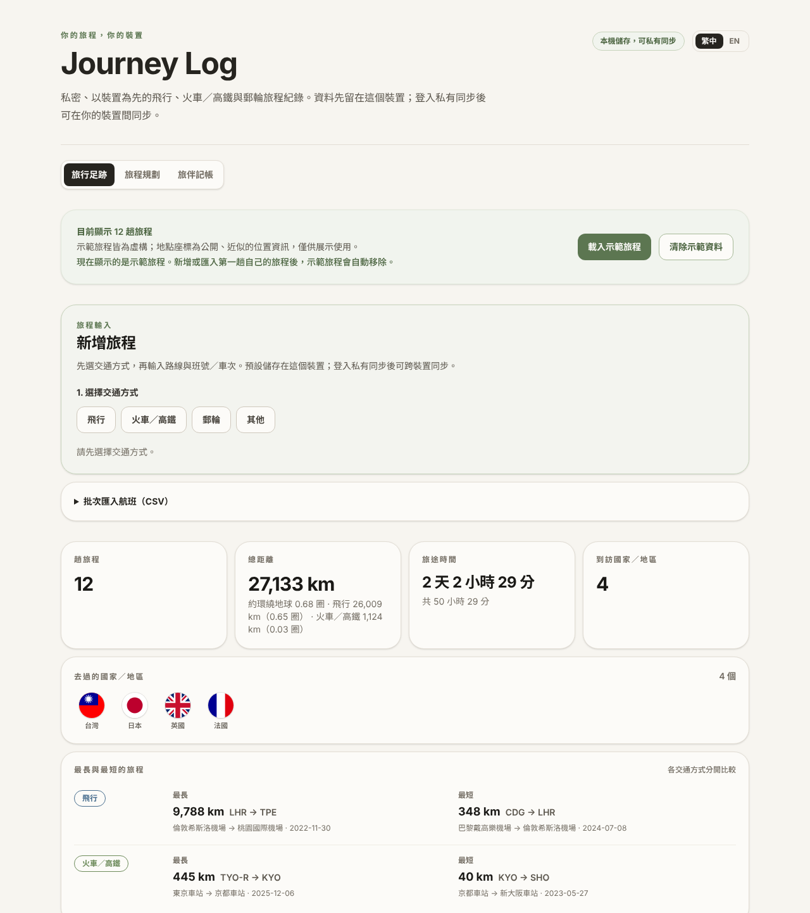
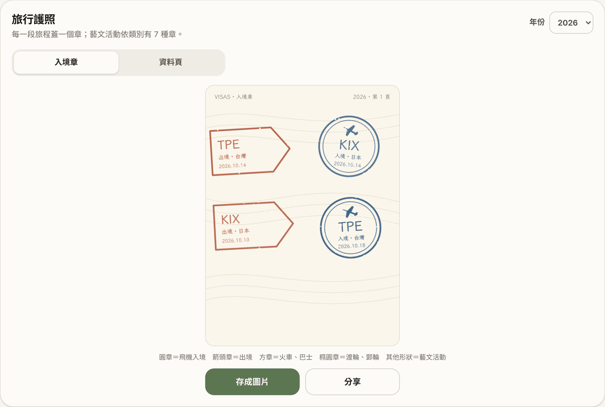
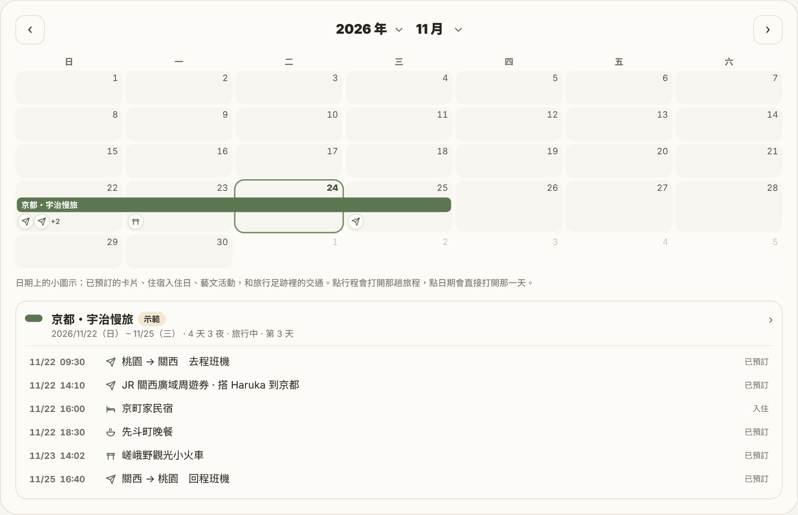
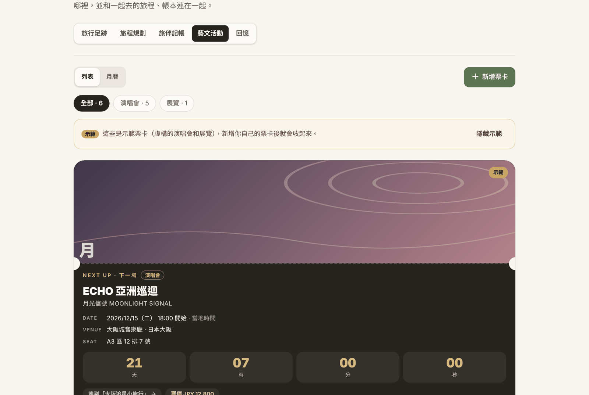
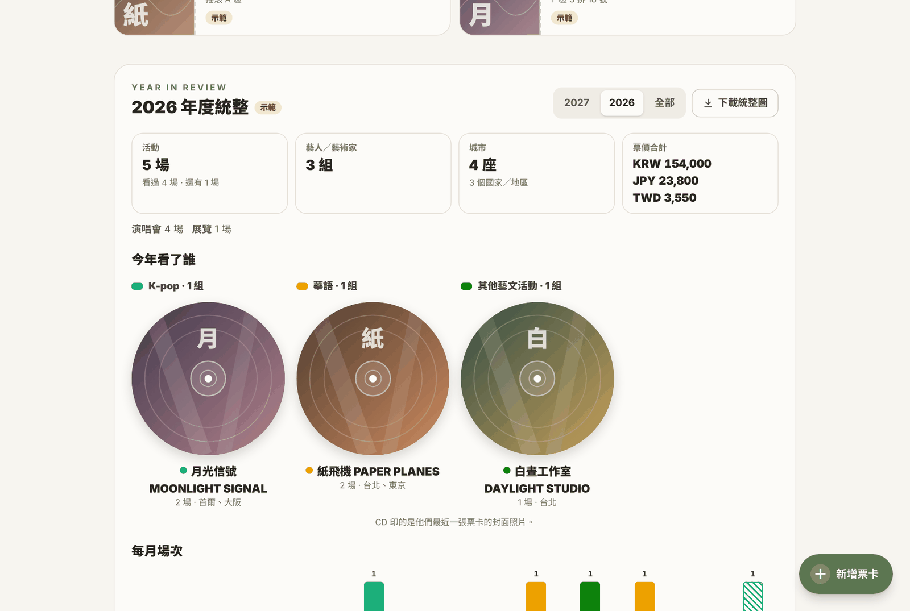
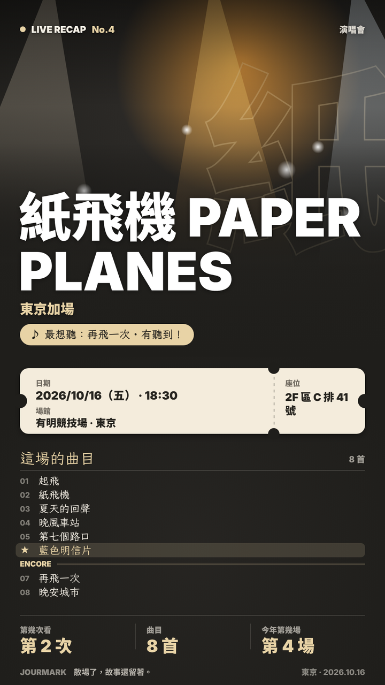
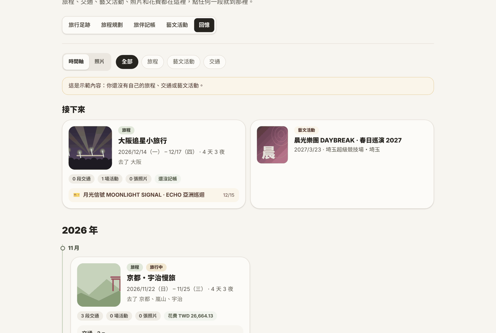
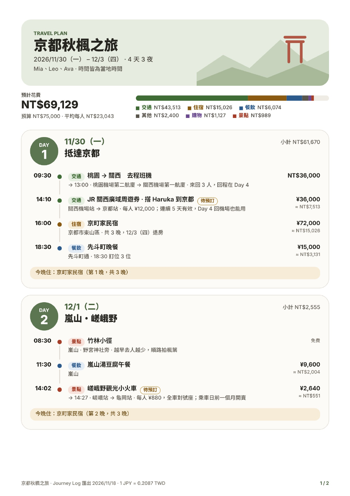
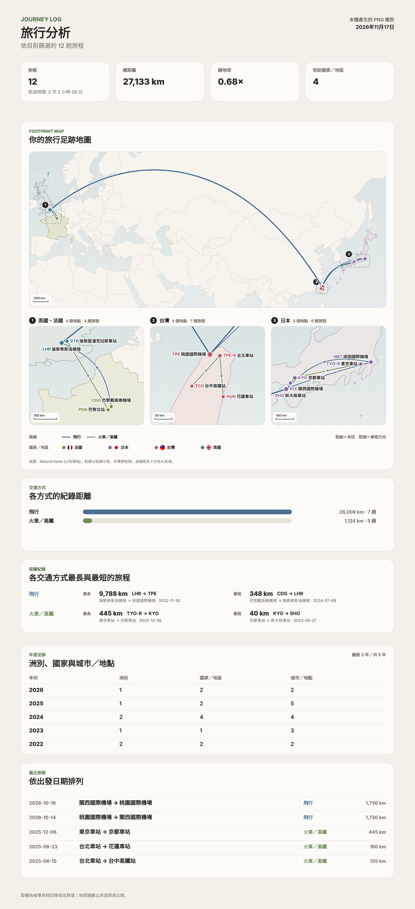
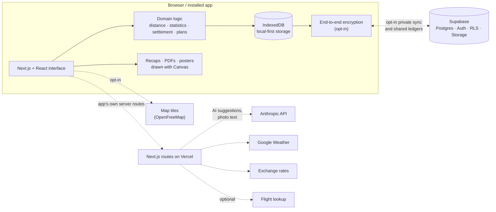

# Jourmark｜逐拾 — travel log, trip planner, arts & events, and trip expense splitter

> **逐心所向，拾途成印** · Follow your heart. Keep every mark.
>
> 從出發到散場，沿途風景與舞台記憶，都值得珍藏。
> From the first departure to the final encore, every view and every show is worth keeping.

**Live app:** https://jourmark.com (sample data included; no sign-in needed to try it)

Jourmark (逐拾, formerly Journey Log) is a local-first, installable web app (PWA) for everything around
a trip: a log of every flight, train, bus, car trip, ferry and cruise; a
day-by-day trip planner that works as a travel companion while you are away;
a ticket wallet for the concerts, musicals and exhibitions people travel to
see; a multi-currency ledger for splitting costs with travel companions; and a
**Memories** timeline that ties them together. Data stays on the device by
default, with optional end-to-end-encrypted sync and shared ledgers.

This repository is the public overview of the project. The source code is kept
private; see [Source code](#source-code).

> **簡介**：Jourmark 逐拾（原名 Journey Log）是一個「資料先存在自己裝置」的旅行 App，裝在手機主畫面就像一般 App，離線也能用。五個分頁：
> - **旅行足跡**：記錄飛機、火車／高鐵、巴士、自駕、渡輪、郵輪；貼上電子機票或訂位信自動加入，轉機自動串成一趟；統計、國旗、旅行護照、路線地圖和可分享的足跡報告圖。
> - **旅程規劃**：一天天安排行程卡片、待辦、預算；AI 行程建議、天氣預報、行程月曆；出發後打開就看到「接下來」要去哪；下載成 PDF、長圖、行事曆或行程檔，回來後還能做整趟旅行回顧。
> - **旅伴記帳**：多幣別分帳（平均、指定金額、按份數），記錄還款，可以邀請旅伴共用同一本帳（端對端加密）；喜愛清單可以拍商品包裝，AI 辨識原文並翻譯。
> - **藝文活動**：演唱會、音樂劇、展覽的票卡、倒數、月曆，排進旅程；年度統整（CD、每月場次、藝文足跡地圖）和演唱會海報風格的演出回顧圖。
> - **回憶**：把旅程、演出、交通、照片和花費串在同一條時間軸上。
>
> 介面支援繁體中文與英文。
>
> **為什麼做這個 App**：我很喜歡旅行，以往都用 Flighty 記錄飛行足跡，但它只能記航班，在歐洲常搭的火車和高鐵都沒辦法記錄。和朋友出遊分帳時，用過的記帳 App 往往不直覺、不能自動換匯，或有很多廣告。所以我做了一個自己想用的工具：所有交通方式記在同一個地方、行程和花費連在一起、沒有廣告，資料也留在自己手上。2026 年 10 月碩士畢業後開始構思，11 月開始開發。

## Screenshots

| On a phone: the trip under way, arts & events, the ledger, memories |
| --- |
|  |

| Journeys & statistics | Travel passport |
| --- | --- |
|  |  |

| Trip planner, on the trip | Trip calendar |
| --- | --- |
|  |  |

| Arts & events | Year in review |
| --- | --- |
|  |  |

| Show recap image | Memories |
| --- | --- |
|  |  |

| Ledger settlement | Plan exported as an A4 PDF |
| --- | --- |
|  |  |

| Shareable PNG recap | Uneven splits |
| --- | --- |
|  |  |

*Screenshots use the app's fictional sample data (sample artists and trips;
real venues and stations). The live app shows the same samples until you add
your own.*

## Features

### Journey log (旅行足跡)
- **Every kind of journey** — flights, rail / high-speed rail, buses, car trips,
  ferries, cruises and others, with autocomplete over ~9,800 airports and
  76,000+ rail stations bundled with the app, operator recognition from flight
  and train numbers, and time-zone-aware durations.
- **Fast entry** — paste an e-ticket or booking confirmation and the flights are
  read from the text; import a whole flight history from CSV; optionally look
  up a day's flights on a route. Connecting legs join into one journey with the
  wait between them.
- **Statistics & look-backs** — distance, travel time, "laps of the Earth",
  countries with round flags, a travel passport stamped from the log, the
  longest and shortest journey per mode, and visits per year; search and
  filters fold into one row until needed.
- **Maps** — an opt-in interactive MapLibre map (OpenFreeMap tiles), and a PNG
  recap whose footprint map fits itself to where you have been and adds
  close-ups for dense regions, drawn in the browser.

### Trip planner (旅程規劃)
- **Day by day** — cards for transport, stays, sights, food, shopping and
  events: local times, places with a map link, booking status, notes, photos or
  built-in illustrations, and costs in any currency. Drag cards between days and
  an ideas list; to-dos with owners, key information, and a budget that compares
  planned costs with what the linked ledger recorded.
- **On the trip** — a trip under way opens on today with a "next up" card: what
  is on now, the next stop with its map link, how many are left today,
  tomorrow's first stop once today is done, and where tonight is spent. On a
  phone the sections and day buttons stay pinned while the plan scrolls.
- **Helpers** — AI trip suggestions (Anthropic Claude Haiku 5.5, online only)
  that fill empty time around what is already booked and are checked by code
  for overlaps, missed trains and unrealistic timing; a 10-day weather forecast
  per day (Google Weather API); trip photos sorted into days by the date taken;
  a daily diary.
- **Calendar** — a month calendar of trips and key dates (bookings, check-ins,
  events, journeys) with year and month lists; export to `.ics` or Google
  Calendar.
- **Exports** — an A4 PDF whose days flow from page to page, a phone-width
  image, a plan file (JSON, photos included) that imports back, and a
  whole-trip recap (PNG or PDF) with photos, journeys and spending.

### Travel split (旅伴記帳)
- **Multi-currency ledgers** — about 150 currencies settle into one, each
  expense keeping the exchange rate confirmed when it was recorded. Split
  equally, by exact amounts or by shares; record repayments; one ledger per
  trip; search, filters, spending charts and CSV export. A new ledger walks
  through three setup steps.
- **Shared ledgers** — invite companions with a link as editors or viewers; the
  entries stay end-to-end encrypted, and each person sees what they owe or will
  get back.
- **Favourites list** — photograph a product's packaging; AI reads the original
  text and translates it, keeping both, so it can be found again in any
  language (a monthly allowance per account, counted in the database).

### Arts & events (藝文活動)
- **Ticket wallet** — concerts, recitals, musicals, plays, dance and
  exhibitions: artists, venue and city (a bundled GeoNames city list, so
  nothing typed is sent anywhere), seat, price, ticket photos and a stub photo
  whose QR code is found and painted over on the device; setlist, most-wanted
  song and the night's favourite.
- **Countdown, list and calendar** — the next show counts down in the venue's
  time zone. A ticket linked to a trip becomes an event card on that day of the
  plan, and its price can be recorded in the trip's ledger.
- **Year in review** — shows, artists, cities and spending; a CD per artist
  printed with their ticket photo, grouped by genre with a colour family per
  genre (checked for colour-vision deficiency); shows by month; a footprint
  map; venues. Downloads as a PNG or PDF.
- **Show recap** — each past show makes a 9:16 image in the style of a concert
  poster, its colours taken from the show's own photo.

### Memories (回憶)
- One timeline of trips, shows, transport, photos and spending, linked both
  ways: a trip shows its shows and journeys, a ticket shows its trip, an expense
  knows which trip or event it belongs to.

### Across the app
- **Local-first & private** — IndexedDB on the device; optional private sync
  (Supabase) that can be end-to-end encrypted, downloads only what changed, and
  never silently overwrites a concurrent edit.
- **Installable & offline** — a PWA with an offline cache saved per release; an
  installed app that falls behind a deployment offers to update; on iPhones the
  tab bar sits above the home indicator.
- **Bilingual & accessible** — every screen in Traditional Chinese and English;
  audited with axe on phone and desktop sizes in light and dark mode, with
  finger-sized tap targets and keyboard alternatives to dragging.

## How it works

Nothing leaves the device unless the person opts in. API keys live only on the
server; the browser itself talks to just this site, Supabase and the map tiles,
which the Content Security Policy enforces. Recaps, PDFs and the show posters
are generated in the browser.

## Tech stack

Next.js (App Router) · React · TypeScript (strict) · Tailwind CSS ·
Dexie / IndexedDB · Zod · MapLibre GL · Canvas 2D · Web Crypto · Supabase
(Postgres, Auth, Row Level Security, Storage) · Anthropic API · Vitest ·
Playwright · GitHub Actions · Vercel

## Engineering highlights

- **Money is never a float.** Amounts are integer minor units; conversion uses
  exact decimals, largest-remainder allocation makes every split add up to the
  total, and each expense keeps its own frozen rate.
- **Privacy by construction.** End-to-end encryption with per-account keys;
  shared ledgers get a random space key wrapped by each member's key, and an
  invite's secret lives only after the `#` in its link. The database only ever
  sees ciphertext for encrypted accounts and rejects anything else.
- **Sync safety.** Every cloud write is revision-checked in a Postgres function;
  sync downloads only rows written since the last one (by transaction id), and
  conflicts are shown for the person to resolve.
- **AI with guardrails.** Suggestions are checked in code (overlaps, double
  bookings, being somewhere before you could get there, too little time before
  a booked train or flight) and anything removed is explained. Reading photo
  text has a monthly allowance per account, counted in the database under an
  advisory lock (and handed back if a reading fails); suggestion requests are
  rate-limited on the server.
- **Pages that flow.** The plan PDF lays days out like text — a day continues on
  the same page and splits between cards, never leaving a heading alone at the
  foot of a page — and is drawn on a canvas so Chinese text needs no font
  download.
- **Maps that make sense.** A fitted Web-Mercator projection picks its central
  meridian from the largest empty longitude gap, and Natural Earth rings that
  cross the anti-meridian are made continuous, so no country smears across the
  map.
- **Colour you can tell apart.** Artist genres get colour families whose shades
  are picked by OKLab distance, also under simulated colour blindness, with
  initials on every chart segment so colour is never the only cue.
- **Installed apps stay current.** Each release registers its own service
  worker, which saves the pages and their files and drops the previous
  release's cache; a version endpoint lets a resumed app offer to reload.
- **Tested.** 560+ unit tests cover the business logic; about 55 Playwright
  scenarios run against the production build on both a desktop and a phone
  viewport, including a check that no request is blocked by the Content
  Security Policy. Lint, types, unit tests, the build and the end-to-end tests
  run on every change.

## How this was built

This is a personal portfolio project: I began planning it in October 2026,
after finishing my MSc, and started building it in November 2026 with AI coding
agents (OpenAI Codex and Anthropic Claude). I defined the product and its requirements,
directed the design decisions, wrote the rules the agents follow, and reviewed
and tested the results on my own phone.

Examples of decisions I made along the way:

- **Scope** — one place for every kind of journey, then the plan, the money and
  the shows around a trip, linked so a trip's story can be found in one place.
- **Privacy** — data stays on the device by default; sync is opt-in, can be
  end-to-end encrypted, and sharing a ledger requires encryption on both sides.
- **AI that is honest** — picking a model whose knowledge is current, requiring
  the plan to stay logical (no duplicated transport, time to catch booked
  trains), and keeping an offline example for when AI is unavailable.
- **iPhone first** — testing on a real device: switching sign-in to a one-time
  code (emailed links open in Safari, not the installed app), moving the tab
  bar above the home indicator, and adding an update prompt.
- **Design** — reviewing layouts on a design canvas before code; a calm,
  low-saturation palette; handwriting type for personal words and sans-serif
  for posters and reports; a concert-poster recap for shows.
- **Data quality** — questioning implausibly long journeys before saving, and
  fixing map artefacts found in real data.

## Source code

The source code is in a private repository, because I may develop Jourmark
further and release it. If you are reviewing my work for a role and would like
to see the code, please contact me through
[LinkedIn](https://www.linkedin.com/in/hsi-liang-claire/) and I will gladly
give you read access or walk you through it.

## Contact

Feedback, questions or problems with the app: [jourmark.app@gmail.com](mailto:jourmark.app@gmail.com)
（意見回饋或問題請寫信到這個信箱）. The same address is at the bottom of every
page of the app.

## License

© 2026 Claire Liang (梁曦). All rights reserved. See [`LICENSE`](LICENSE).
